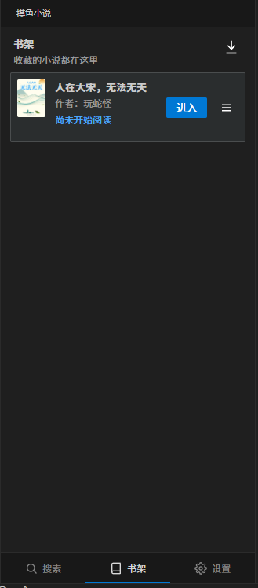
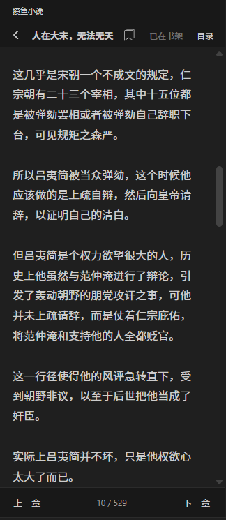
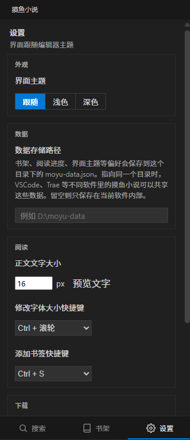

# 摸鱼小说

在编辑器侧边栏里搜索、识别并阅读网页小说的 VS Code / Trae / Cursor 扩展。界面颜色跟随当前编辑器主题，正文只保留纯文本，适合低干扰阅读。

## 功能展示

**搜索页**：用必应搜索书名，也可以直接粘贴小说网页地址，只识别该网站。


**识别到的小说**：搜索结果经过识别后展示书籍信息（封面、作者、章节数、简介），可以进入阅读、加入书架或下载。


**书架**：收藏的小说集中展示，记录阅读进度，右上角可以进入下载管理。



**正文阅读**：顶部返回、书签、加入书架、目录，底部上一章 / 下一章和章节进度。支持 `Ctrl + 滚轮` 调整字体大小、`Ctrl + S` 添加书签。



**设置**：界面主题（跟随编辑器 / 浅色 / 深色）、数据存储路径、正文文字大小（带实时预览）、字体大小与书签快捷键、下载设置。



## 安装

### 方式一：插件市场

在 VS Code / Cursor / Trae 等编辑器的扩展面板中搜索「**摸鱼小说**」（或 `moyu-novel`），点击安装。

### 方式二：本地安装 vsix

从 [GitHub Releases](https://github.com/torisu-kirame/VSCode-moyu-js/releases) 下载最新版本的 `moyu-novel-x.x.x.vsix`，然后：

- **界面安装**：打开编辑器的扩展面板 → 右上角 `···` 菜单 → **从 VSIX 安装…** → 选择下载的文件。
- **命令行安装**（适用于所有支持 vsix 的 IDE，命令换成对应编辑器的 CLI 即可）：

```powershell
# VS Code
code --install-extension "moyu-novel-0.1.6.vsix"

# Cursor
cursor --install-extension "moyu-novel-0.1.6.vsix"

# Trae
trae --install-extension "moyu-novel-0.1.6.vsix"

# VSCodium / Windsurf 等其它衍生 IDE 同理，使用各自的命令行入口
```

安装后重新加载窗口（`Ctrl+Shift+P` → `Reload Window`），点击左侧活动栏的鱼图标即可使用。

> 提示：Cursor 默认从 Open VSX 搜索扩展，市场里搜不到时用上面的 vsix 方式安装。

## 功能

- 安装后在活动栏显示鱼形图标，点开就是阅读器。
- 用必应搜索书名，并打开结果页判断是不是小说。
- 识别为书籍后只保留正文，导航、广告和其他页面元素不会进阅读页。
- 目录会按站点分页继续翻页，尽量读完整章列表，而不是只显示当前这一页。
- 书籍可以加入书架，阅读进度会记在本机。
- 下载的书会保存为本地文件夹，内含封面资料、目录缓存和章节正文 txt。
- 正文支持修改键 + 滚轮调整字体大小，修改键 + `S` 添加书签；两个修改键都可以在设置中改。
- 设置里可以配置数据存储路径，书架、进度、主题、书签等写入 `moyu-data.json`。VS Code 和 Trae 指向同一目录即可共享数据。
- 内置示例小说可离线阅读；也可以改成自己的远程接口。

## 使用

1. 重新加载窗口后，点击左侧活动栏的鱼图标。
2. 也可以按 `Ctrl+Shift+P`，运行 **摸鱼小说：打开阅读器**。
3. 在搜索框输入书名，或直接粘贴一个网页地址。粘贴网址时只打开并识别这个网站，不会再去搜其他网页。识别成书籍的结果可以选择「阅读」或「加入书架」。
4. 没有识别成书籍的链接会用系统浏览器打开。
5. 阅读页可以切换上一章、下一章，打开目录跳转，或用快捷键调整字体、添加书签。

## 运行环境

搜索网页小说和抽取正文时，会调用本机的 **Microsoft Edge**（无头模式）。请先安装 Edge。内置示例小说不需要浏览器，也不需要联网。

部分网站会拦截自动访问。遇到这种情况时，目录或正文可能读不全，过一会儿再打开同一本书会重新尝试。

## 设置

在编辑器设置里搜索「摸鱼小说」：

| 设置 | 作用 |
| --- | --- |
| `moyuNovel.source` | `demo` 使用内置示例；`remote` 使用远程接口。 |
| `moyuNovel.remoteApiBase` | 远程接口根地址，仅在来源为 `remote` 时使用。 |

插件内的设置页还提供：界面主题、数据存储路径、正文文字大小及预览、字体大小快捷键（修改键可改，滚轮固定）、书签快捷键（修改键可改，`S` 固定）、下载路径与自动下载。

远程接口约定：

- `GET {base}/search?q=关键字`，返回 `{ data: Book[] }`
- `GET {base}/book/{id}/chapters`，返回 `{ data: Chapter[] }`
- `GET {base}/book/{id}/chapter/{chapterId}`，返回 `{ data: { title, content } }`

## 数据保存

书架、进度、主题、书签等默认保存在扩展的本机存储里；在设置中填写数据存储路径后，会同步写入该目录下的 `moyu-data.json`，供不同编辑器共享。下载的书会写到设置里的下载路径，每本书一个文件夹：

- `book.json`：该书的基本信息、目录、书签、阅读进度与下载完成情况
- `assets/`：封面图片、作者、类型等检索信息
- `cache/`：目录、爬取摘要、阅读位置（保留 30 天）
- `MainTXT/`：章节正文 txt

换一台电脑或卸载扩展后，扩展内书架不会跟着走；下载文件夹里的文件仍在磁盘上。